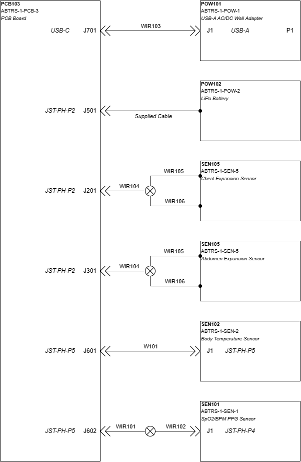
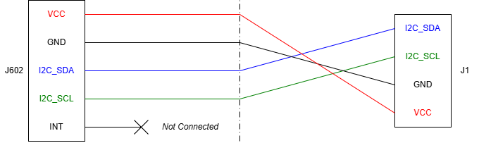

# System-Level Wiring Diagram

## 1. Description

This file will contain an overview of the system-level wiring needed for this project.  In general, it shows the connections between the primary PCB and its peripheral devices.

## 2. Diagram

 

    

 

## 3. Explanation

### 3.1 POW101

The connection between PCB103 and POW101 represents the connection use for charging the system.  WIR103 represents a USB-A to USB-C charging cable, which is then connected to a USB-A AC/DC Wall Adapter, for charging.

### 3.2 POW102

The connection between PCB103 and POW102 represents the connection between the primary PCB board and the LiPo battery used during post-exercise recovery sessions.  The connection on the side of the LiPo battery is fixed, represented by the black dot and the *Supplied Cable* tag.

### 3.3 SEN105 & SEN106

These two connections represent the breathing band sensor connections to the PCB, which are identical for both connections.  Similar to the LiPo battery, the connection is fixed on the breathing band sensor side.  Two wires are soldered to either end of the breathing band, and then soldered again to a JST-PH-2P connector on the PCB side.  These soldering points are represented as a *splice* (*i.e., a circle with an ex through it*).

### 3.4 SEN102

The connection between PCB103 and SEN102 represents the body temperature sensor and the primary PCB.  Interestingly, the body temperature sensor chose for this project requires a simple, thin PCB for itself, so that the sensor may act as a probe.  As such, the body temperature sensor PCB will be fitted with a JST-PH-5P receptacle to match the 5 pins on the primary PCB side.

### 3.5 SEN101

The connection between PCB103 and SEN101 represents the SpO2/BPM PPG sensor connection.  Contrary to the body temperature sensor, the PPG sensor only has 4 pins.  As such, a cable assembly needs to be created in a way where the 4 used I2C pins will be routed correctly to the PPG sensor's 4 pins.  The fifth, unused wire will be removed, to ensure the fifth pin on the JST-PH-P5 plug connector of the cable assembly is dead.  In addition, the pin ordering for the senso chosen does ot follow the JST standard pin ordering, meaning that the cable assembly must be soldered carefully.  The pin orderings have been documented and a suggested cable assembly wiring has been given below.

 

    

