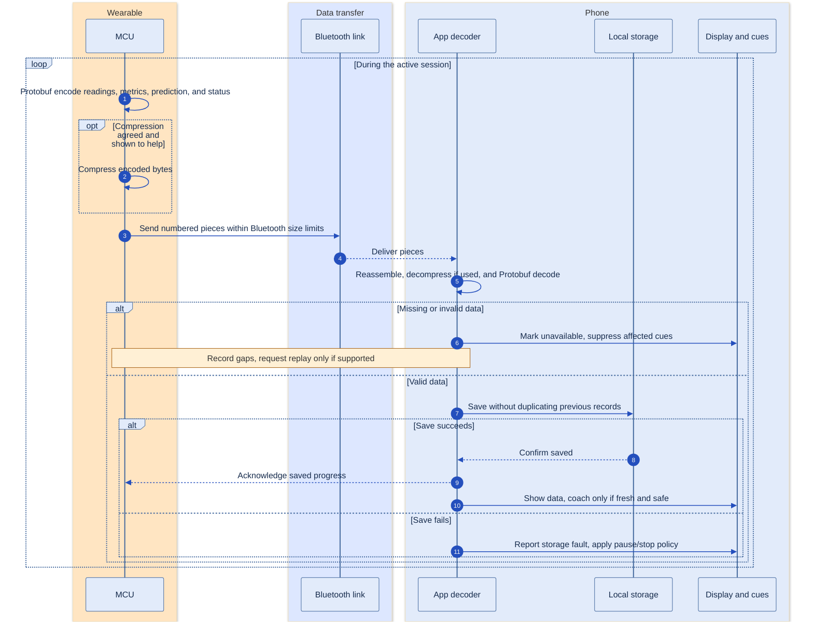
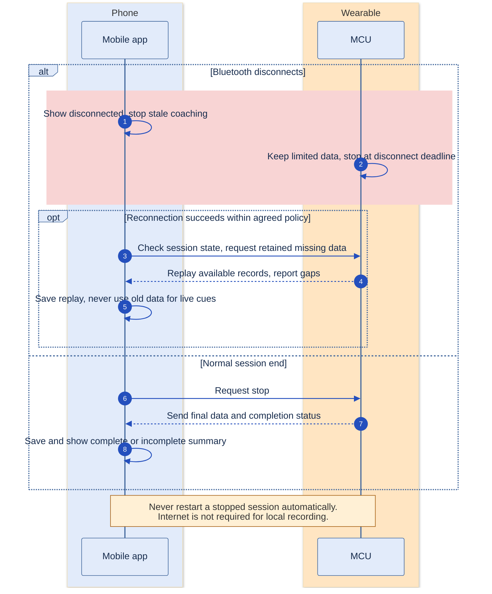

# Bluetooth and data-transfer sequences

Proposed design for team review. Orange identifies the MCU, blue identifies Bluetooth, and light blue identifies phone components. Each column is a component, not necessarily a separate device.

## Establish a session

## Encode, transfer, decode, and store

Protobuf converts structured data into bytes; it is not a compression codec. The phone reverses the same steps in the opposite order. Safety alerts are handled promptly when received without waiting for normal storage acknowledgements.

## Disconnection and session completion

## What must both ends agree on?

These are proposed interface agreements, sometimes called a **contract**. They ensure the MCU and phone interpret the same bytes the same way. They do not mean these features are implemented.

| Topic | Proposed agreement |
| --- | --- |
| Packet contents | Same Protobuf schema, field meanings, and units |
| Timing and identity | Identify the session, message order, and measurement time |
| Message size | Split large messages and limit memory used for reassembly |
| Missing data | Detect gaps/duplicates; use limited replay only if implemented |
| Safety and stopping | Suppress stale cues and agree when disconnected sessions stop |

Exact identifiers, byte layouts, acknowledgement/replay behavior, size limits, and timeouts remain open decisions. The [Bluetooth implementation notes](implementation-notes/ble-sequence.md) retain the detailed proposed contract and test cases.
