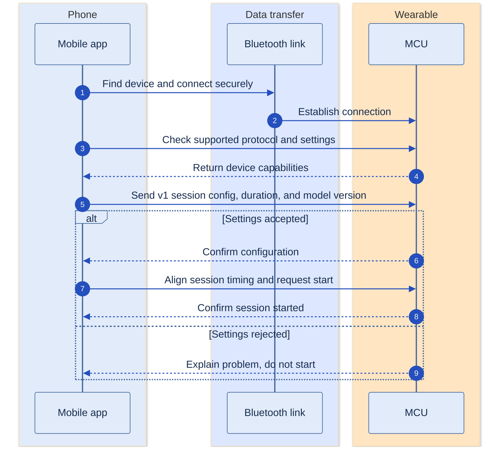
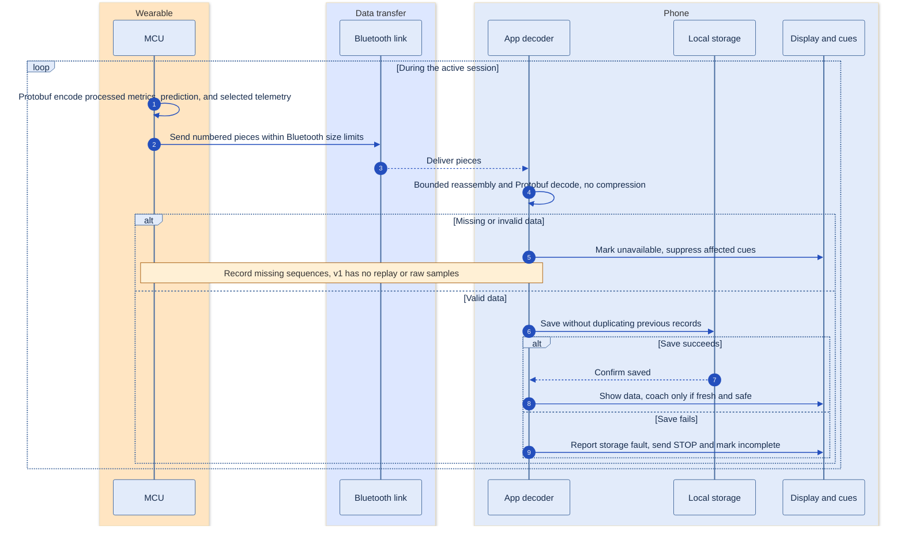
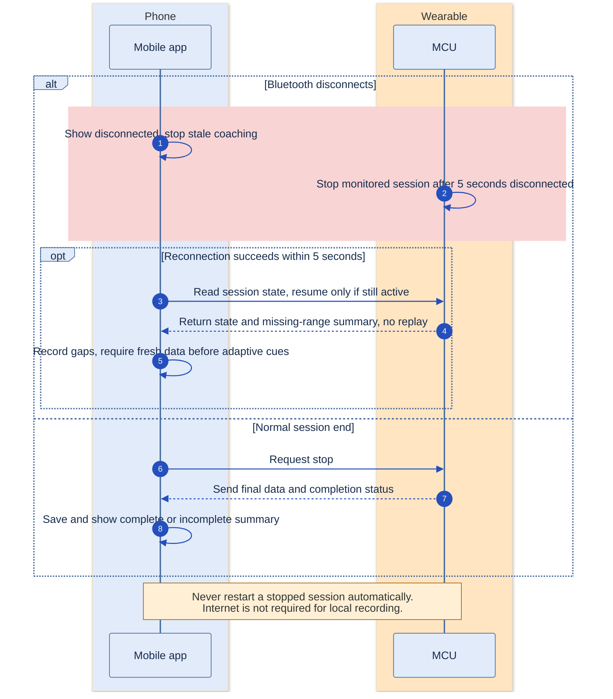

# Bluetooth and data-transfer sequences

Proposed design for team review. Orange identifies the MCU, blue identifies Bluetooth, and light blue identifies phone components. Each column is a component, not necessarily a separate device.

## Establish a session

## Encode, transfer, decode, and store

Protobuf serializes the selected fields into bytes and the phone decodes them. v1 uses no additional compression. Process fault/status messages immediately; recording has no telemetry ACK dependency.

## Disconnection and session completion

## Selected transfer contract

Use Protobuf schema v1 with no compression. Raw belt samples never enter telemetry packets. Transfer processed metrics, predictions, selected measurements, and validity/status at 1 Hz. Control commands have explicit result replies; telemetry uses best-effort notifications with gap detection, no replay, and no telemetry-storage ACK.

The [v1 specification](design-spec-v1.md#bluetooth-protocol-v1) fixes the UUIDs, eight-byte fragment header, 512-byte message bound, two-second reassembly timeout, queue limits, and five-second disconnection stop. On lost/invalid data suppress affected cues; on local storage failure stop the session.
