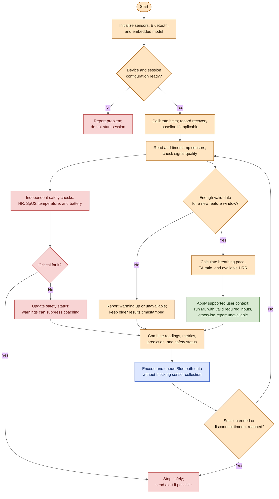

# MCU layer flowchart

Proposed design for team review. Orange = MCU, green = ML, blue = Bluetooth, red = safety/fault handling.

## Session processing

The two branches after sensor collection describe work that must both happen. Safety checks continue while features are warming up or ML is unavailable. Critical stops do not wait for Bluetooth delivery. The phone independently suppresses stale cues after a disconnect. Initialization retries and transmission queues must have limits.

## Metric definitions and validity

| Metric | Meaning |
| --- | --- |
| Breathing pace | Breaths per minute from accepted peaks and valleys in the breathing signals |
| TA ratio | Calibrated chest amplitude divided by abdomen amplitude; agree the exact window calculation |
| HRR1 / HRR2 / HRR3 | Exercise-end heart rate minus heart rate after 1 / 2 / 3 minutes of recovery |

HRR requires a valid exercise-end baseline and remains unavailable until its recovery time has passed. It differs from HRV in the older diagram. Invalid or missing values must not become zero or an invented prediction.

## Inputs, outputs, and open decisions

- **Inputs:** chest/abdomen signals, HR, SpO2, body/device temperature, battery, and supported session/profile context.
- **Outputs:** timestamped readings, metrics, an ML result or unavailable status, and safety information.
- **To agree:** sampling rates, window length, calibration, safety limits, and disconnect behavior.

Detailed formulas, data fields, and checks are in the [MCU implementation notes](implementation-notes/mcu-flow.md). They support implementation; they are not extra steps to present in the meeting.
