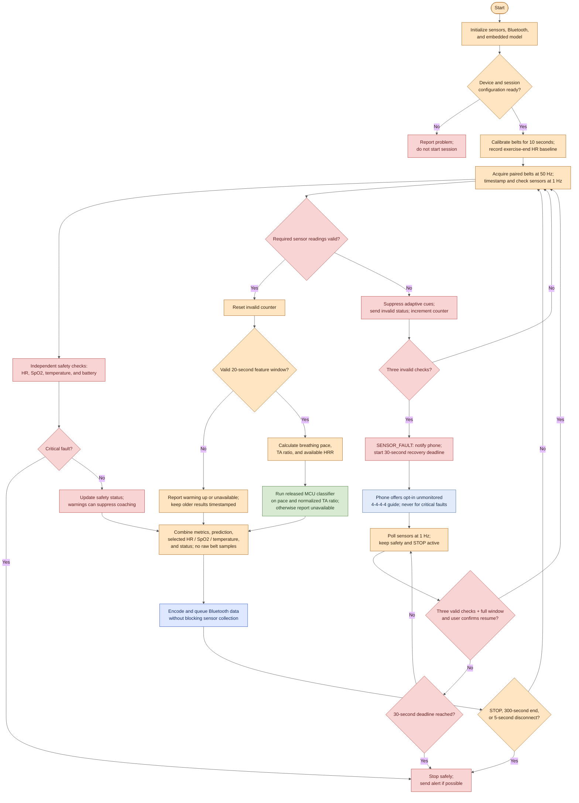

# MCU layer flowchart

Proposed design for team review. Orange = MCU, green = ML, blue = Bluetooth, red = safety/fault handling.

## Session processing

Safety checks run independently of inference. Raw belt samples stay on the MCU; only processed metrics, predictions, selected telemetry, and status are sent. WARMUP or missing early HRR is not a broken sensor. The one-second health check fails on missing/stale required readings or sensor/status errors.

Three consecutive invalid checks enter SENSOR_FAULT. Adaptive cues stop on the first invalid check. The phone may offer the opt-in unmonitored box guide during the 30-second recovery period; a critical fault stops everything. Recovery requires three valid checks, a fresh full feature window, and user confirmation. The deadline always provides an exit for a broken sensor.

Exact calculations, limits, and protocol are selected in [design specification v1](design-spec-v1.md).
