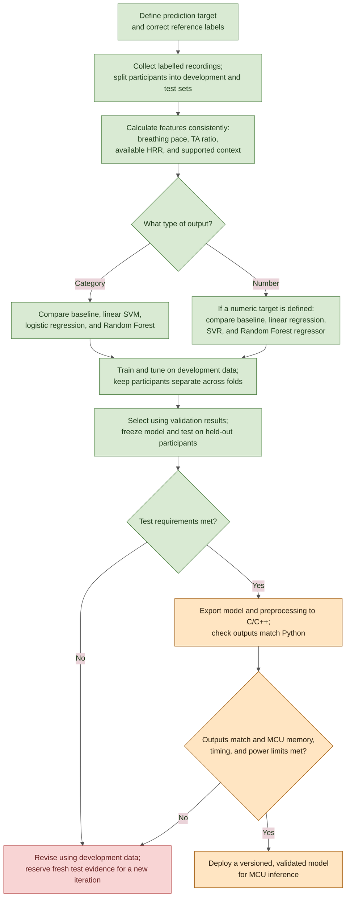
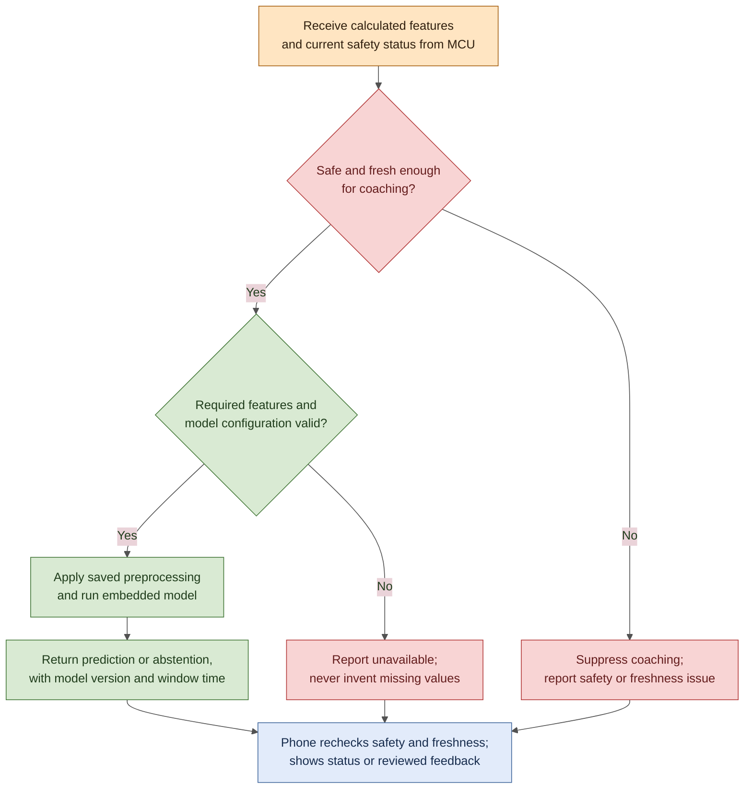

# Machine learning layer flowcharts

Proposed supervised-learning design for team review. Green = ML, orange = MCU deployment, light blue = phone, red = unavailable results or safety actions.

## Offline development and model comparison

Training happens on a development computer or optional cloud compute. The validated model runs on the MCU. A separate reinforcement-learning/Azure feature would need its own agreed design.

## Runtime inference and decision handling

When HRR is missing early in a session, use a separately validated reduced-feature model or report unavailable. Safety checks operate independently of ML and cannot be overridden by a prediction.

## Features, labels, and outputs

| Term | Meaning for this design |
| --- | --- |
| Features | Calculated pace, TA ratio, available HRR, and justified profile context |
| Labels | Correct training answers; breathing-pattern categories need a reviewed definition and annotation method |
| Prediction | Model estimate with timing, model version, and validity status |
| Safety inputs | HR, SpO2, and temperature monitored through separate rules |

Possible labels for discussion are thoracic-dominant, abdominal-dominant, and mixed breathing. They are not approved categories or diagnoses. Linear regression requires a separately defined numeric target; it is not compared directly with classifiers as though they solve the same task.

Detailed data fields, model comparisons, evaluation rules, and deployment checks are in the [ML implementation notes](implementation-notes/ml-flow.md). See the [shared open decisions](README.md#decisions-needed-before-implementation) for team review.
