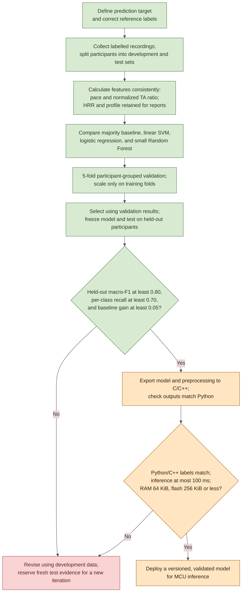
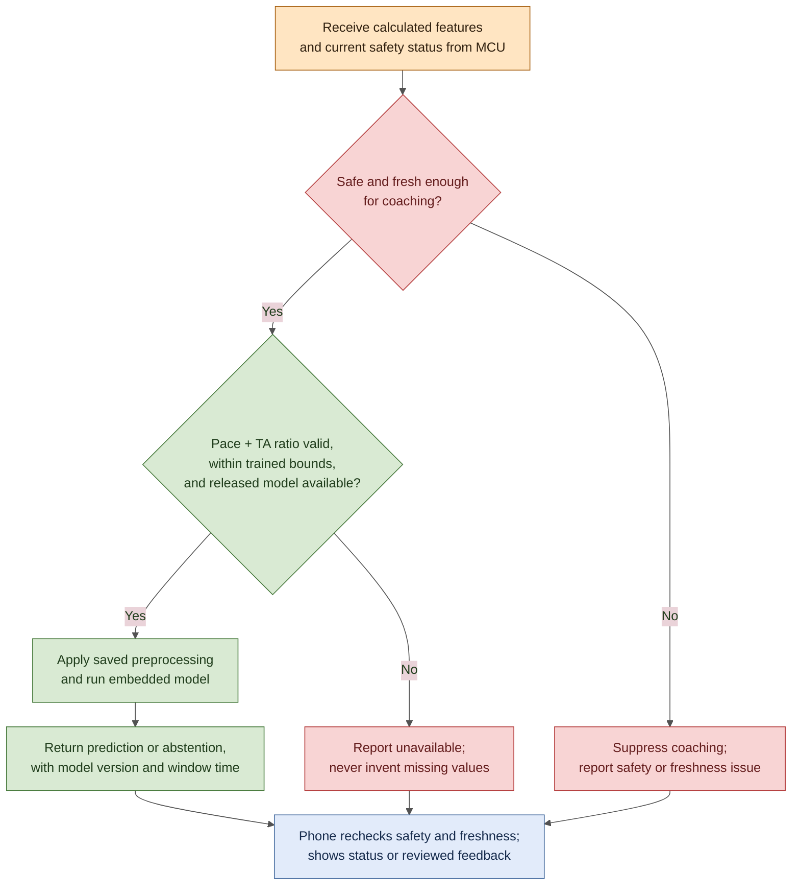

# Machine learning layer flowcharts

Proposed supervised-learning design for team review. Green = ML, orange = MCU deployment, light blue = phone, red = unavailable results or safety actions.

## Offline development and model comparison

Training happens on a development computer or optional cloud compute. The validated model runs on the MCU. A separate reinforcement-learning/Azure feature would need its own agreed design.

## Runtime inference and decision handling

The v1 model uses pace and normalized TA ratio only, so unavailable early HRR does not require imputation or another model. Invalid features return unavailable. Without a released model, record selected telemetry without adaptive pattern coaching. Safety and sensor-fault handling remain independent.

## Selected features, labels, and release

Before the machine learning model can commence its analysis, the embedded layer must perform certain data pre-proccessing activities.  These pre-processing activities are executed based on two inputs, namely the raw data being read from the sensors, and the session context which is created by the application at the beginning of the session.  The following variables are considered during pre-processing, over a given window of time:

* Heart Rate (*BPM*), which will allow you to either determine or interpolate Heart Rate Recovery (*HRR*), depending on how much time has elapsed.
* Chest Contribution, which is the measure of how much the chest has expanded/contracted over the current analysis period.
* Abdominal Contribution, which is the measure of how much the abdomen has expanded/contracted over the current analysis period.

From these raw metrics, the following features can be extracted:

* HRR1 (*After 1 minute has elapsed*), HRR2 (*After 2 minutes have elapsed*), HRR3 (*After 3 minutes have elapsed*), all of which deteren the user's current state of recovery.
* Thoracic-to-Abdominal Ratio, which will illustrate the user's breathing posture (*e.g., Belly Breathing or Chest Breathing*).
* Breathing Pace, which can be inferred from the peaks and valleys of the user's chest and abdominal readings.

Such features, along with certain session context values, can be fed to the machine learning model, allowing for a thourough analysis of the user's recovery.  Once the model's analysis is complete, labels will assigned to the user's state of recovery, such as `THORACIC_DOMINANT`, `ABDOMINAL_DOMINANT`, and `MIXED`, among others.  In the embedded layer's output handling process, these labels will be encoded into a 3-bit sequence, before ultimately being encoded into a session data packet en route to the mobile application.

Labels are annotated by two reviewers from synchronized guided trials; retain consensus intervals only. These describe breathing movement patterns, not anatomical posture or diagnoses.  Hold out 20% of participants (at least two) and require at least ten participants before release. Select the best eligible validation macro-F1; within 0.01 prefer linear SVM, then logistic regression, then the smaller forest. No numeric regression, demographic lookup, RL, or Azure service is included in v1. No model is released until data, held-out accuracy, export-parity, and on-device gates pass.

See [ML specification v1](design-spec-v1.md#ml-specification-v1) for exact parameters and failure behavior.
