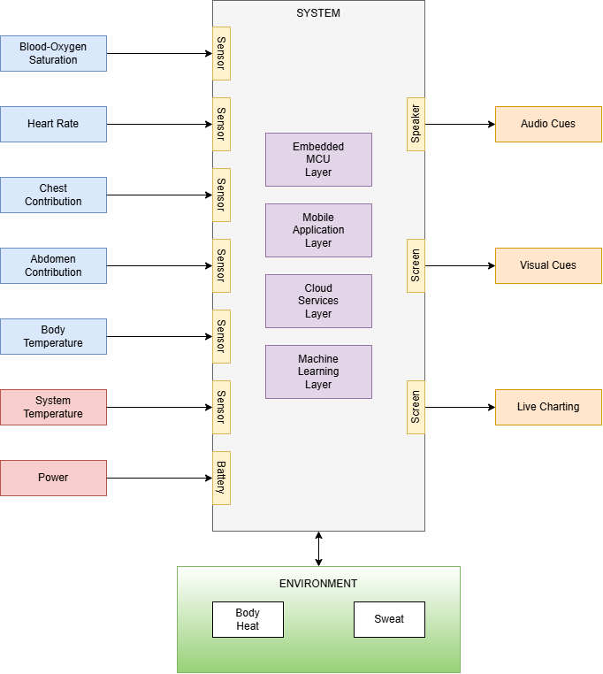

# Black Box Diagram

## 1. Description

This file will contain a detailed black box diagram for the ABTRS System Architecture.  This diagram will build off of what has already been presented in PHASE I of this capstone project.  Through the processes of incremental design and R&D, the black box reresentation of this system has evolved past its initial rudimentary illustration.

## 2. Diagram

## 3. Explanation

### 3.1 Inputs

### 3.2 Outputs

### 3.3 Internal Process

### 3.4 Environment

### 3.5 Power
