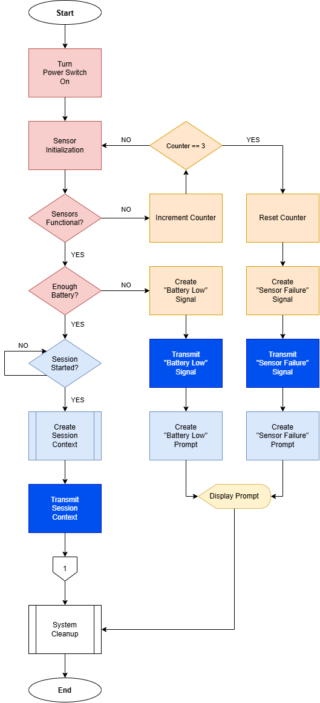
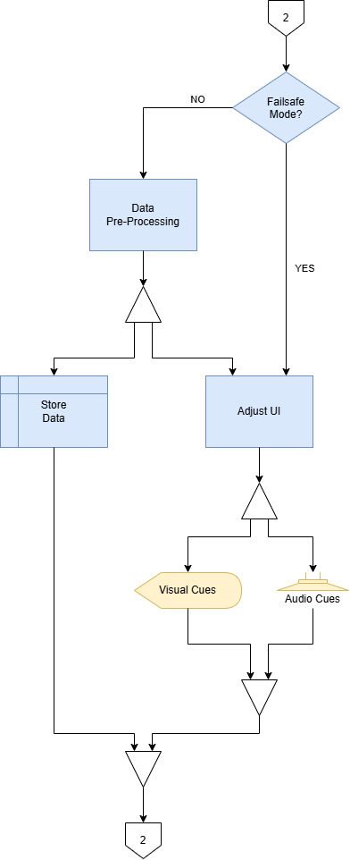

# System Operation

## 1. Operational Flowchart

### 1.1 Overarching Process

The flowcharts shown below belong to the overarching process of the ABTRS system.  Due to the sheer size of the overarching process, the primary operational flowchart has been split into three flowcharts, all shown and explained below.  The system operational flowchart is meant to illustrate the full process of the entire system for a given post-exercise recovery session.  In addition, the flowchart considers certain errors that can be encountered, and how the system should handle them.  While the major errors have been covered here, separate flowcharts and activity sequence diagrams contain more details regarding data communication, extenuating circumstances, and other software structures that cannot be captured accurately in a flowchart.

 

    

 

The first of the three flowcharts shows the starting and ending points of the system's operation, including manually turning the system on, and how the system must terminate after the user has completed their session.  On the right side of the diagram, the flowchart covers two major errors encountered during system initialization.  In the case of sensor connectivity issues, or low battery, the user will be notified so as to take appropriate action, before the system begins termination.  If neither error is encountered, the system will remain on standby, until the user commences a session.  Once a session is started, the mobile application must create the appropriate context for the current session, gathering important user data and inferring important comparison metrics.  Once this sub-process is complete, the session context is transmitted to the embedded system hostedby the user's wearable device.

 

    

 

The second of the three flowcharts shows the bulk of the system's processing logic, shared between all the major software architecture layers.  The process shown by this flowchart is characterized by the primary system loop, which will be active throughout a given post-exercise recovery session.  The input handling process will package the incoming time-stamped raw sensor values with the session context created by the mobile application.  Once this sub-process is complete, the embedded layer must ensure the created data packet is valid (*i.e., not missing any sensor data*).  If the produced packet it valid, the raw sensor data must be pre-processed to calculate and extract key metrics for breathing and recovery analysis.  These metrics, called *features*, along with certain contextual values, must be passed to the machine learning model, which itself will conduct the breathing and recovery analysis, before producing its decisions, called *labels*.  These labels will then be packaged along with the raw sensor data and the windowed metrics in the output handling sub-process, before finally being transmitted to the mobile application.  Once this entire process is complete, the mobile application must determine if the session is complete.  If it is not, the primary loop repeats, whereas if it is, the mobile application must execute the post-session processing sub-process.

Interestingly, the paragraph above has only explored the case where the sensor data is valid.  In the unlikely event that the sensor data is invalid (*e.g., corrupted, missing, inaccurate, etc.*), the system will keep polling for valid sensor data.  If it cannot find any, the system will commence the failsafe process, wherein the remainder of the session will follow a standard box breathing pattern.  This will allow the user to finish their session with a proven recovery method, while the system attempts to find the next valid data packet.  Once this warning signal is received by the mobile application layer, steps will be taken to notify the user of the incident, and the subsequently account for the failsafe portion in the post-session report.

 

    

 

The final flowchart shows the last portion of the primary system loop, which is entirely contained within the mobile application layer.  Here, the user interface is adjusted based on the data being received from the embedded layer (*OR, in the case of failsafe, adjusted to demonstrate the standard box-breathing cues*).  Adjustments to the audio-visual cues are made based on the labels received indirectly from the machine learning model.  Any data recived from the current packet is also stored locally with other historical data, which will be pertinent for post-session dashboards.

 

### 1.2 "Create Session Context" Process

### 1.3 "System Cleanup" Process

### 1.4 "Input Handling" Process

### 1.5 "Output Handling" Process

### 1.6 "Post-Session Processing" Process

## 2. Operational Sequence Diagram
