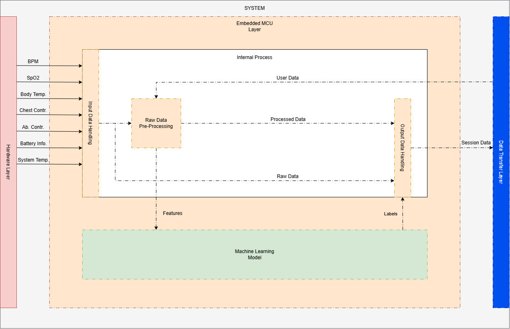
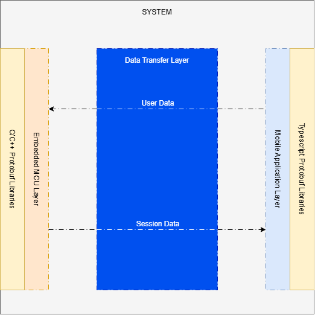
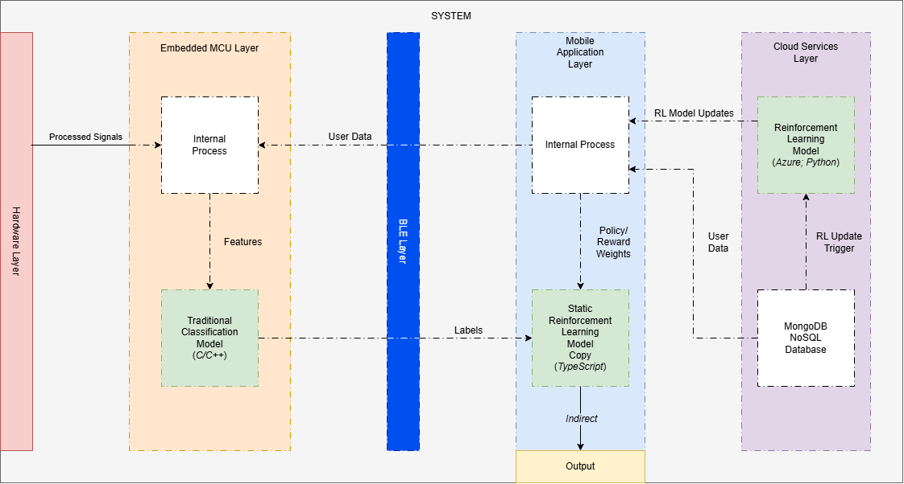

# White Box Diagram

## 1. Description

This file will contain a detailed white box diagram for the ABTRS System Architecture.  This diagram will build off of the black box architecture that was presented in PHASE I of the capstone project.  The scope of this diagram will focus on the internal processes described in the black box diagram.  Specific software business logic and hardware details will be shared in the ```software-documentation``` and ```hardware-documentation``` folder, respectively.

**NOTE:** In the diagram below, there will be layers, processes and arrows that are represented with both solid and dashed lines.  For solid lines, this generally means that the components, process, input, or output is physical (*i.e., pertaining to the hardware*).  Contrarily, in most cases, if the lines are dotted, this represents virtual components of the system (*i.e., pertaining to the software*).

## 2. Diagram

<div align="center">
    
</div>

## 3. Explanation

The system being developed for this project contains several interconnecting, and, at times, overlapping layers.  While this diagram above is simplified, it provides a digestable portrayal of the different levels of abstracion contained within the ABTRS system.  In the sections below, each layer is explored in more detail.

### 3.1 Hardware Layer

<div align="center">
    
</div>

<br>

The image above provides an expanded view of the hardware layer, as well as the different physical components contained within it.  The *Battery Sensing & Management Sub-Circuit* has been decomposed to illustrate the many components which have been selected to create it.  Namely, this sub-circuit is composed of and external AC power source used to charge the internal power source as needed, between sessions.  On the other hand, the internal power source is used for system operation during a given session.  In addition, this sub-circuit uses a Power Management Integrated Chip (*PMIC*), which regulates the power distribution between the charging, battery, and microcontroller endpoints.  The PMIC also sends battery information to the MCU layer, which will be useful to transmit to our mobile application layer.  In terms of input signals, three of our five signals are transmitted digitally, whereas the other two are purely analog, meaning that a dedicated *Signal Processing Sub-Circuit* module is needed to attenuate any present noise.  Finally, once the input signals have been processed by the MCU layer, they must packaged, encoded, and compressed, before being transmitted to the mobile application layer via the data transfer layer.

<br>

### 3.2 Embedded MCU Layer

<div align="center">
    
</div>

<br>

The image above provides an expanded view of the ambedded microcontroller layer, called the *MCU Layer*.  Here, the MCU layer is built on C/C++ to create a fast and reliable data processing and handling framework for the ABTRS system.  The input handling logic will capture and clean any remaining noise present within the input signals, before passing it to the pre-processing logic.  In addition, certain characteristics of the user, such as their age, bioligical sex, weight, etc., will be sent from the mobile app to microcontroller via the data transfer layer to provide contextual information.  The pre-processing logic will infer several calculated metrics over a given window of time, extracting distinguishable *features* from the data.  Such features will be passed to a *Machine Learning Model*, hosted on the microcontroller.  From these features, the algorithm will output certain *labels*, which will then be passed back to the primary internal process of the MCU layer.  Finally, the input signals, calculated, windowed metrics, and labels will be packaged, encoded, compressed, and sent to the data transfer layer.

<br>

### 3.3 Data Transfer Layer

<div align="center">
    
</div>

<br>

The image above provides an expanded view of the bridge between the MCU and Mobile Application layers, known as the *Data Transfer Layer*.  This is a purely virtual layer created using a continuous data communication protocol.  Information communicated from the mobile application layer to the MCU layer consists of relevant user data which will provide contextual data for the microcontroller-hosted machine learning model.  In the other direction, a high-volume, real-time data stream will be running throughout a given post-exercise recovery session.  Due to the nature of this data stream, and the specific architecture chosen for the mobile application, using an uncompressed data stream will cause the mobile application layer to fail.  As such, the ```Protobuf``` protocol buffer framework must be implemented to lighten the load of this layer.  In accordance with this framework, specific libraries are needed for both the MCU and mobile application layers, in their respective languages.

<br>

### 3.4 Mobile Application Layer

<div align="center">
    
</div>

<br>

The image above provides an expanded view of the application layer of the system, called the *Mobile Application Layer*.  Due to the heavy real-time stream of data transported over the data transfer layer, the application layer does not follow a traditional architecture, where the backend handles a majority of the operations, and the frontend serves as a pure user interface (*UI*).  In this case, mobile application is treated as a single layer, handling incoming/outgoing data, controlling the user interface outputs, and storing session and user data simultaneously.  During a given session, the application will process incoming data packets, sending them to be:

1. Stored in a local database.
2. Output to the user via several audio-visual elements.

In the event that a disruption occurs during the session, a failsafe operation will be defined to ensure the session can end gracefully.  In terms of inter-session activity, the user will be able to view a long-term, comprehensive dashboard of their overall progress.

<br>

### 3.5 Machine Learning Layer

<div align="center">
    
</div>

<br>

The image above provides an isolated view of the machine learning model used in the system, called the *Machine Learning Layer*.  The machine learning model will be deployed on the microcontroller, and as such will operate under stringent power, resource, and timing constraints.  The goal of the model is to identify the breathing pace and posture of the user, which will give the system a better comprehension of their state of recovery.  This model will originally be developed, trained, and tested in Python, but will subsequently be translated to C/C++ for practical use.  To maximize the performance of the model, the design of the model must strike a balance between the size and accuracy of the model, taking into account the aforementioned constraints.

<br>
