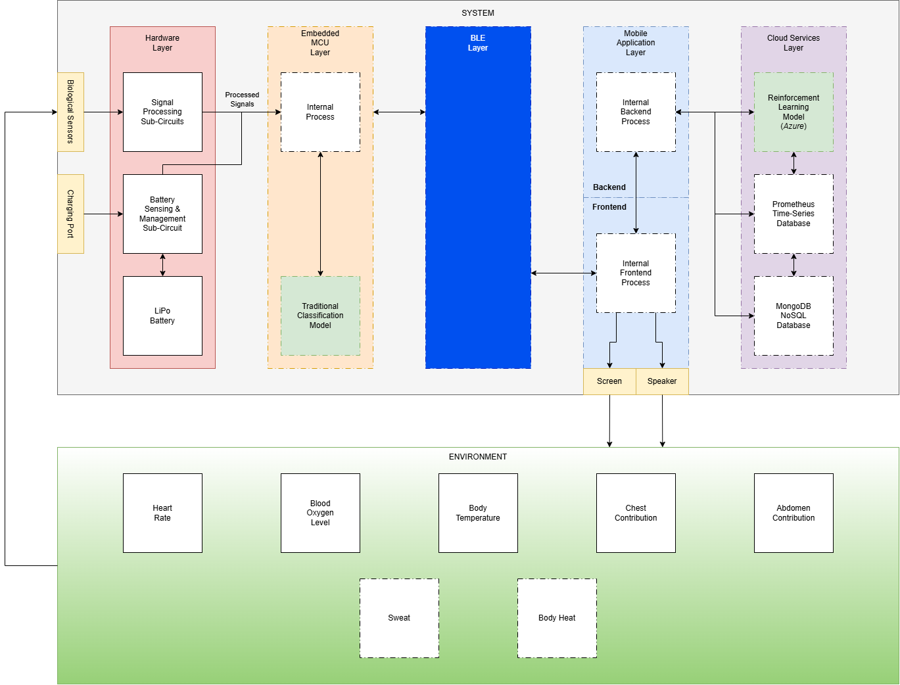
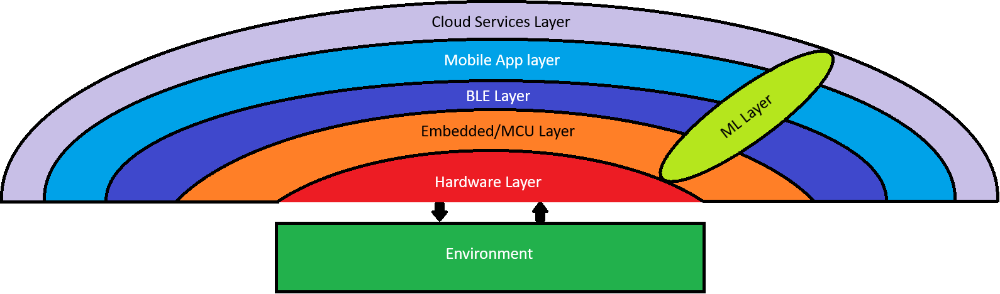

# White Box Diagram

## 1. Description

This file will contain a detailed white box diagram for the ABTRS System Architecture.  This diagram will build off of the black box architecture that was presented in PHASE I of the capstone project.  The scope of this diagram will focus on the internal processes described in the black box diagram.  Specific software business logic and hardware details will be shared in the ```software-documentation``` and ```hardware-documentation``` folder, respectively.

## 2. Diagram

<div align="center">
    
</div>

## 3. Explanation

<div align="center">
    
</div>

<br>

As seen in the image above, the system being developed for this project contains several interconnecting, and, at times, overlapping layers.  While this diagram is rudimentary, it provides a digestable portrayal of the different levels of abstracion contained within the ABTRS system.  In the sections below, each layer is explored in more detail.

<br>

### 3.1 Hardware Layer

<div align="center">
    
</div>

<br>

The image above provides an expanded view of the hardware layer, as well as the different physical components contained within it.  The *Battery Sensing & Management Sub-Circuit* has been decomposed to illustrate the many components which have been selected to create it.  Namely, this sub-circuit is composed of The USB-C charging port and LiPo Battery connector, which will be used to connect the peripheral power sources to the ABTRS system.  In addition, this sub-circuit uses a Nordic Power Management Integrated Chip (*PMIC*), which regulates the power distribution between the charging, battery, and microcontroller endpoints.  The PMIC also sends battery information to the MCU layer, which will be useful to transmit to our mobile application layer.  In terms of input signals, three of our five signals are transmitted digitally, whereas the other two are purely analog, meaning that a dedicated *Signal Processing Sub-Circuit* module is needed to attenuate any present noise.  Finally, once the input signals have been processed by the MCU layer, they must packaged, encoded, and compressed, before being transmitted over BLE by the *BLE Sub-Circuit* module.

<br>

### 3.2 Embedded MCU Layer

<div align="center">
    
</div>

<br>

The image above provides an expanded view of the ambedded microcontroller layer, called the *MCU Layer*.  Here, the MCU layer is built on C/C++ to create a fast and reliable data processing and handling framework for the ABTRS system.  The input handling logic will capture and clean any remaining noise present within the input signals, before passing it to the pre-processing logic.  In addition, certain characteristics of the user, such as their age, bioligical sex, weight, etc., will be sent from the mobile app to microcontroller over BLE, to provide contextual information.  The pre-processing logic will infer several calculated metrics over a given window of time, extracting distinguishable *features* from the data.  Such features will be passed to a *Traditional Classification Machine Learning Model*, hosted on the microcontroller.  From these features, the algorithm will output certain *labels*, which will then be passed back to the primary internal process of the MCU layer.  Finally, the input signals, calculated, windowed metrics, and labels will be packaged, encoded, compressed, and sent to the BLE layer.

<br>

### 3.3 BLE Layer

<div align="center">
    
</div>

<br>

The image above provides an expanded view of the bridge between the MCU and Mobile Application layers, known as the *BLE Layer*.  This is a purely virtual layer created using a Generic Attribute Profile (*GATT*) Bluetooth Low-Energy (*BLE*) communication protocol.  Information communicated from the mobile application layer to the MCU layer consists of relevant user data which will provide contextual data for the microcontroller-hosted machine learning model.  In the other direction, a high-volume, real-time data stream will be running throughout a given post-exercise recovery session.  Due to the nature of this data stream, and the specific architecture chosen for the mobile application, using an uncompressed data stream will cause the mobile application layer to fail.  As such, the ```Protobuf``` protocol buffer framework must be implemented to lighten the load of the BLE layer.  In accordance with this framework, specific libraries are needed for both the MCU and mobile application layers, in their respective languages.

<br>

### 3.4 Mobile Application Layer

<div align="center">
    
</div>

### 3.5 Cloud Services Layer

<div align="center">
    
</div>

### 3.6 Machine Learning Layer

<div align="center">
    
</div>
