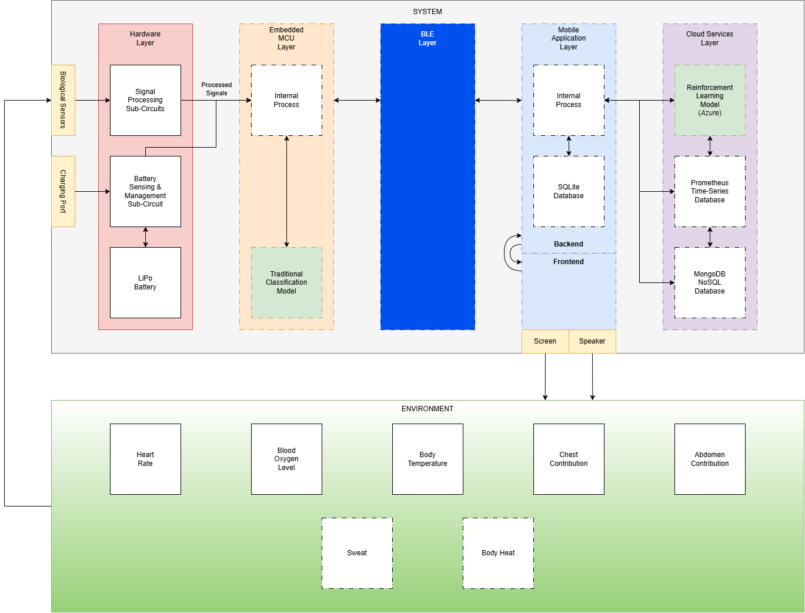
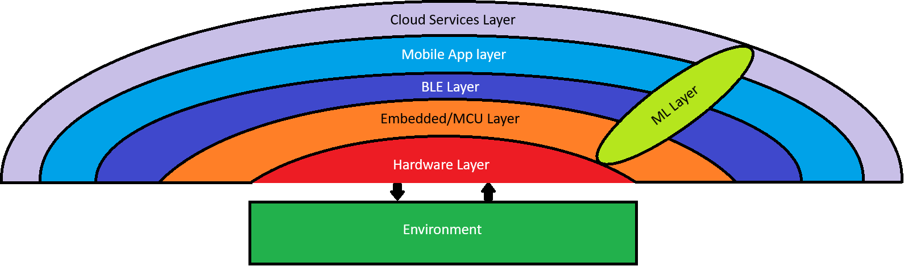
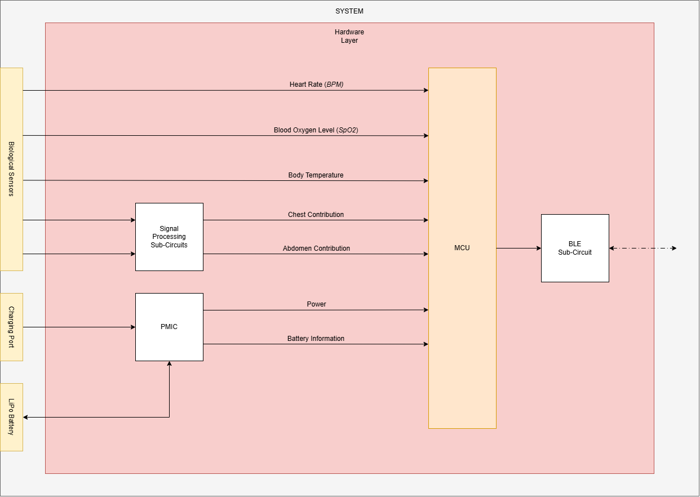

# White Box Diagram

## 1. Description

This file will contain a detailed white box diagram for the ABTRS System Architecture.  This diagram will build off of the black box architecture that was presented in PHASE I of the capstone project.  The scope of this diagram will focus on the internal processes described in the black box diagram.  Specific software business logic and hardware details will be shared in the ```software-documentation``` and ```hardware-documentation``` folder, respectively.

## 2. Diagram

<div align="center">
    
</div>

## 3. Explanation

<div align="center">
    
</div>

<br>

As seen in the image above, the system being developed for this project contains several interconnecting, and, at times, overlapping layers.  While this diagram is rudimentary, it provides a digestable portrayal of the different levels of abstracion contained within the ABTRS system.  In the sections below, each layer is explored in more detail.

<br>

### 3.1 Hardware Layer

<div align="center">
    
</div>

<br>

The image above provides an expanded view of the hardware layer, as well as the different physical components contained within it.  The *Battery Sensing & Management Sub-Circuit* has been decomposed to illustrate the many components which have been selected to create it.  Namely, this sub-circuit is composed of The USB-C charging port and LiPo Battery connector, which will be used to connect the peripheral power sources to the ABTRS system.  In addition, this sub-circuit uses a Nordic Power Management Integrated Chip (*PMIC*), which regulates the power distribution between the charging, battery, and microcontroller endpoints.  The PMIC also sends battery information to the MCU layer, which will be useful to transmit to our mobile application layer.  In terms of input signals, three of our five signals are transmitted digitally, whereas the other two are purely analog, meaning that a dedicated *Signal Processing Sub-Circuit* module is needed to attenuate any present noise.  Finally, once the input signals have been processed by the MCU layer, they must packaged, encoded, and compressed, before being transmitted over BLE by the *BLE Sub-Circuit* module.

<br>

### 3.2 Embedded MCU Layer

<div align="center">
    
</div>

### 3.3 BLE Layer

<div align="center">
    
</div>

### 3.4 Mobile Application Layer

<div align="center">
    
</div>

### 3.5 Cloud Services Layer

<div align="center">
    
</div>

### 3.6 Machine Learning Layer

<div align="center">
    
</div>
