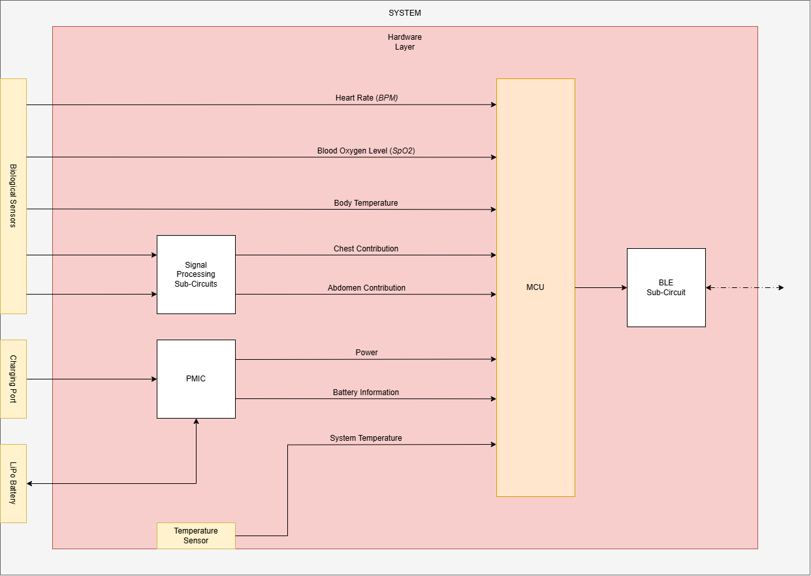
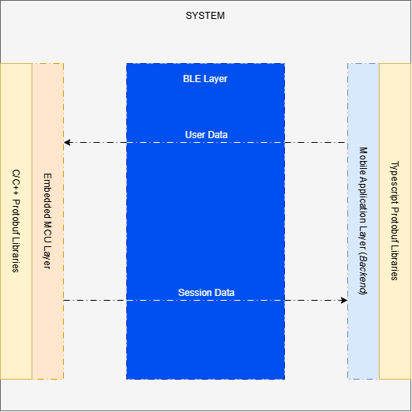
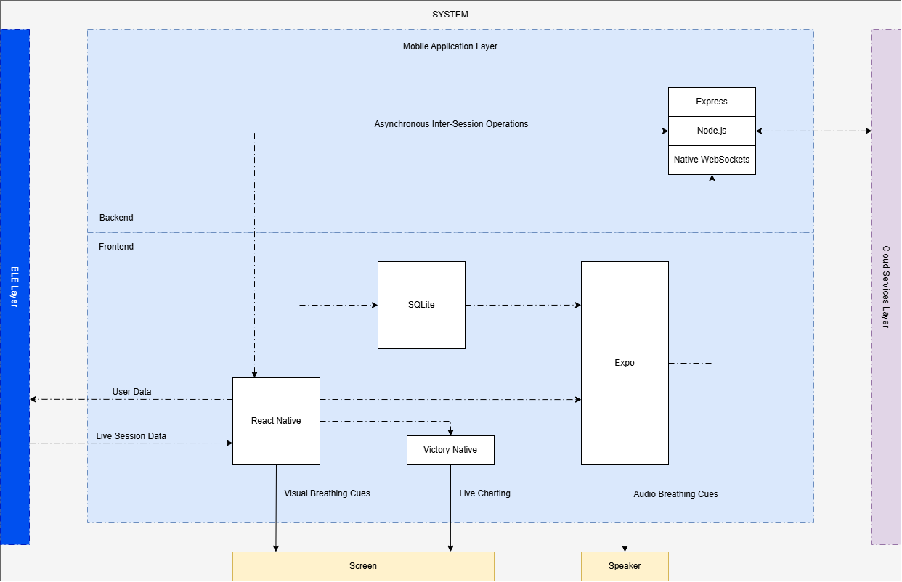
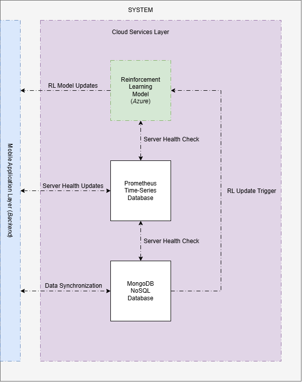

# White Box Diagram

## 1. Description

This file will contain a detailed white box diagram for the ABTRS System Architecture.  This diagram will build off of the black box architecture that was presented in PHASE I of the capstone project.  The scope of this diagram will focus on the internal processes described in the black box diagram.  Specific software business logic and hardware details will be shared in the ```software-documentation``` and ```hardware-documentation``` folder, respectively.

## 2. Diagram

<div align="center">
    
</div>

## 3. Explanation

<div align="center">
    
</div>

<br>

As seen in the image above, the system being developed for this project contains several interconnecting, and, at times, overlapping layers.  While this diagram is rudimentary, it provides a digestable portrayal of the different levels of abstracion contained within the ABTRS system.  In the sections below, each layer is explored in more detail.

<br>

### 3.1 Hardware Layer

<div align="center">
    
</div>

<br>

The image above provides an expanded view of the hardware layer, as well as the different physical components contained within it.  The *Battery Sensing & Management Sub-Circuit* has been decomposed to illustrate the many components which have been selected to create it.  Namely, this sub-circuit is composed of The USB-C charging port and LiPo Battery connector, which will be used to connect the peripheral power sources to the ABTRS system.  In addition, this sub-circuit uses a Nordic Power Management Integrated Chip (*PMIC*), which regulates the power distribution between the charging, battery, and microcontroller endpoints.  The PMIC also sends battery information to the MCU layer, which will be useful to transmit to our mobile application layer.  In terms of input signals, three of our five signals are transmitted digitally, whereas the other two are purely analog, meaning that a dedicated *Signal Processing Sub-Circuit* module is needed to attenuate any present noise.  Finally, once the input signals have been processed by the MCU layer, they must packaged, encoded, and compressed, before being transmitted over BLE by the *BLE Sub-Circuit* module.

<br>

### 3.2 Embedded MCU Layer

<div align="center">
    
</div>

<br>

The image above provides an expanded view of the ambedded microcontroller layer, called the *MCU Layer*.  Here, the MCU layer is built on C/C++ to create a fast and reliable data processing and handling framework for the ABTRS system.  The input handling logic will capture and clean any remaining noise present within the input signals, before passing it to the pre-processing logic.  In addition, certain characteristics of the user, such as their age, bioligical sex, weight, etc., will be sent from the mobile app to microcontroller over BLE, to provide contextual information.  The pre-processing logic will infer several calculated metrics over a given window of time, extracting distinguishable *features* from the data.  Such features will be passed to a *Traditional Classification Machine Learning Model*, hosted on the microcontroller.  From these features, the algorithm will output certain *labels*, which will then be passed back to the primary internal process of the MCU layer.  Finally, the input signals, calculated, windowed metrics, and labels will be packaged, encoded, compressed, and sent to the BLE layer.

<br>

### 3.3 BLE Layer

<div align="center">
    
</div>

<br>

The image above provides an expanded view of the bridge between the MCU and Mobile Application layers, known as the *BLE Layer*.  This is a purely virtual layer created using a Generic Attribute Profile (*GATT*) Bluetooth Low-Energy (*BLE*) communication protocol.  Information communicated from the mobile application layer to the MCU layer consists of relevant user data which will provide contextual data for the microcontroller-hosted machine learning model.  In the other direction, a high-volume, real-time data stream will be running throughout a given post-exercise recovery session.  Due to the nature of this data stream, and the specific architecture chosen for the mobile application, using an uncompressed data stream will cause the mobile application layer to fail.  As such, the ```Protobuf``` protocol buffer framework must be implemented to lighten the load of the BLE layer.  In accordance with this framework, specific libraries are needed for both the MCU and mobile application layers, in their respective languages.

<br>

### 3.4 Mobile Application Layer

<div align="center">
    
</div>

<br>

The image above provides an expanded view of the application layer of the system, called the *Mobile Application Layer*.  Here, the layer is built as an end-to-end TypeScript Expo application.  In addition, several modules, including React Native, SQLite, and Native WebSokctes, among others, are leveraged to create support for both real-time, offline session operations, as well as asynchronous, online inter-session operations.  Due to the heavy real-time stream of data transported over the BLE layer, the application layer does not follow a traditional architecture, where the backend handles a majority of the operations, and the frontend serves as a pure user interface (*UI*).  In this case, the "backend" serves as the link between the application and cloud layers, whereas the "frontend" serve as the primary "core" or "engine" of this system layer.  During a given session, the application will process incoming data packets, sending them to be:

1. Stored in a temporary ```SQLite``` database.
2. Output to the user via several audio-visual elements.

In the event that a disruption occurs during the session, a failsafe operation will be defined to ensure the session can end gracefully.  After the session has ended, provided a Wi-Fi connection has been established, the application layer will complete the following actions:

1. Push the current ```SQLite``` database contents to a ```MongoDB``` database.
2. Re-train, re-test, cross-validate, and update the reward/policy functions for the Reinforcement Learning Algorithm hosted by the cloud layer.
3. Communicate the updated RL weights to the application layer in the form of a ```.json``` file.

Finally, in terms of inter-session activity, the user will be able to view a long-term, comprehensive dashboard of their overall progress.  Hence, the inter-session operations will follow a fundamentally different data path compared to live session operations.

<br>

### 3.5 Cloud Services Layer

<div align="center">
    
</div>

<br>

The image above provides an expanded view of the different servers hosted by the cloud layer, called the *Cloud Services Layer*.  The first of the three services is the Reinforcement Learning Model hosted by an Azure Cloud Space.  This is where the model's policy and reward functions will be trained tested, and updated, before ultimately being sent to the mobile application for use.  The second service is the MongoDB Atlas NoSQL database, which will serve as the long-term storage solution for our users' data.  At the end of a given session, the contents of the mobile application's temporary storage will be pushed to the MongoDB database.  After this has been completed, this service will send the Azure service a signal to trigger its update operations.  The final service contained within this layer is a Prometheus Time-Series database, which will be used to monitor the health of the other two services.  In the event of a service disruption, appropriate action must be taken to mitigate further errors and replace erroneous data by repeating the interrupted post-session operations.

<br>

### 3.6 Machine Learning Layer

<div align="center">
    
</div>

<br>

The image above provides an isolated view of the machine learning components of the system, called the *Machine Learning Layer*.  Unlike the other layers, the machine learning layer spans across the entirety of the system's software architecture.  In the MCU layer, a traditional classification machine learning model will be used to identify the breathing pace and posture of the user, which will give the system a better comprehension of their state of recovery.  This model will originally be developed, trained, and tested in Python, but will subsequently be translated to C/C++ for practical use.  The labels produced by first model will be fed to a Reinforcement Learning Model that is used in the application and cloud layers.  This second model will be used to control the pace of the real-time audio-visual cues being fed to the user.  The actual model, hosted by the Azure Cloud Space ([Section 3.5](#35-cloud-services-layer)), will be developed, trained, and tested in Python, similar to the first model.  However, a static, TypeScript-based copy will live in the application layer for practical use, where strict guardrails will be put in place to ensure the safety of the user.  The TypeScript version of the second model will be updated periodically via a shared ```.json``` file containing the relevant policy/reward weights.  Although this setup breaks certain traditional software architectures, the machine learning layer has been carefully designed to leverage the full capability of the frameworks and physical technology being used in this system.

<br>
